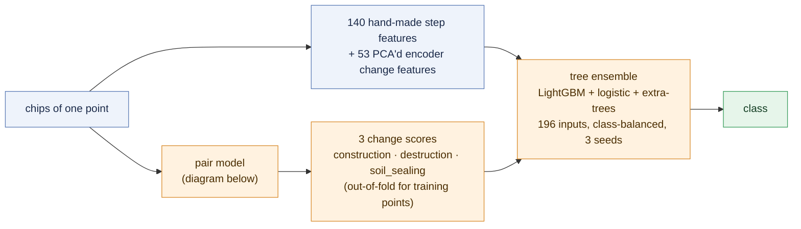
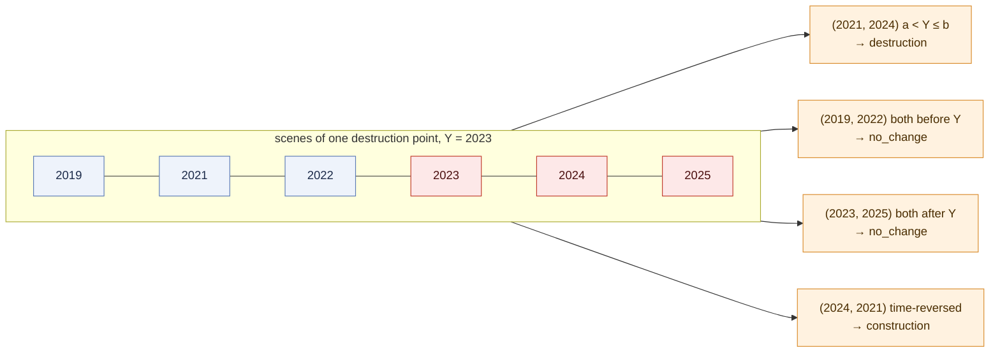

# Eyes on Heritage: change classification

Point-level classification of `construction`, `destruction`, `soil_sealing` and `no_change` from yearly 50 cm satellite imagery, for the AI for Heritage Resilience Hackathon.


## The task and how it is scored

Each test point gets one of `construction`, `destruction`, `soil_sealing`, `no_change` from its yearly image stack. Scoring (from the organisers' evaluation rubric) uses macro-F1 on two hidden sets:

- **M_in**: new grid cells inside the five released sites (Agadez, Aleppo, Derna, Marrakesh, Timbuktu)
- **M_out**: sites never released, most likely **Damascus** (selected, but absent from the training file)

The ranking score is **S = 2·M_in·M_out / (M_in + M_out)**. It stays close to the weaker of the two, so **transfer to an unseen city matters more than fitting the seen ones**. Every class counts equally, so the rare `destruction` (63 labels) and `soil_sealing` (64) classes matter as much as `no_change` (406).

> ⚠️ **Fairness note.** Team 7's own Damascus annotations (on the `main` branch) are very likely part of the hidden test set. The model must **not** train on them, and Damascus imagery should not be used for tuning either. The pipeline only reads `train_annotations.geojson`.

## Data

`train_annotations.geojson`: **776 labelled points** over five sites, one yearly 50 cm RGB scene stack per site (Planet SkySat/Pelican, 5–10 scenes, 2017–2026). Each point has a `class`, a `year` (the year the change first becomes visible; empty for `no_change`) and a few undocumented quality columns.

| Site | construction | destruction | soil_sealing | no_change | total | scenes |
|---|:---:|:---:|:---:|:---:|:---:|:---:|
| agadez | 73 | 11 | 12 | 90 | 186 | 9 (2018–2026) |
| aleppo | 76 | 7 | 20 | 39 | 142 | 10 (2017–2026) |
| derna | 14 | 12 | 21 | 84 | 131 | 5 (2021–2025) |
| marrakesh | 34 | 22 | 3 | 119 | 178 | 8 (2019–2026) |
| timbuktu | 46 | 11 | 8 | 74 | 139 | 8 (2019–2026) |
| **all** | **243** (31 %) | **63** (8 %) | **64** (8 %) | **406** (52 %) | **776** | |

Year of change for the change points (no_change points have none):

| year | 2018 | 2019 | 2020 | 2021 | 2022 | 2023 | 2024 | 2025 | 2026 |
|---|:---:|:---:|:---:|:---:|:---:|:---:|:---:|:---:|:---:|
| construction | 1 | 8 | 20 | 11 | 39 | 93 | 21 | 41 | 9 |
| destruction | 0 | 0 | 5 | 3 | 11 | 24 | 10 | 8 | 2 |
| soil_sealing | 0 | 3 | 4 | 3 | 9 | 42 | 0 | 3 | 0 |

The two rare classes are 8 % each but count as much as `no_change` in the macro-F1. `soil_sealing` is very uneven across sites (41 of 64 in Aleppo + Derna, 3 in Marrakesh) and 42 of them are dated 2023; `destruction` peaks in 2022–2024.

Quality columns in the file (not described in either PDF; their meaning should be confirmed with the organisers): `n_teams` (763 points labelled by a single team), `conflict` (20 points where teams disagreed, mostly construction vs destruction/soil_sealing), `classes_seen`, `verified_ok` (72 points, only in Aleppo, Derna, Marrakesh), `best_accuracy` (one value per team: 49–95), `class_uncertain` (0 everywhere). There is **no per-point confidence** column; the high/medium/low confidence of the annotation exercise was not carried over. The models currently treat all 776 labels equally.

## What the data looks like (and why it is hard)

| Problem | Evidence | What we do |
|---|---|---|
| Scenes differ hugely in sun angle, exposure and haze | Aleppo Dec 2025 / Jan 2026 are much darker than Aug 2022 | per-chip normalisation, chromaticity, correlation-based features |
| Some scenes are close to useless | quality score: Agadez 2018 = 0.03, Derna 2024 = 0.01, Aleppo 2021 = 0.27 | automatic per-scene quality score (sharpness × contrast); bad scenes skipped |
| Roofs move several pixels between years (off-nadir parallax) | mean re-alignment 1–5 px, up to 8 m | each chip re-aligned to the sharpest year by phase correlation |
| Few, noisy labels | 776 points; 20 with annotator conflict | small, regularised models; validation that mimics the test |
| Change year known for training only | `year` is empty for `no_change` | never used as a feature (it would leak the label) |

## Core idea: a real change is a *step*, noise is a *spike*

For every point we compare **every year with every other year** and get a dissimilarity matrix. A demolition or a new building turns it into two blocks (before / after). Shadow, haze, a parked truck or one bad scene light up a single row only. We score the best before/after split and describe what changed across it: brightness, vegetation (excess green), edge density, shadow, texture and edge orientation. The same is done with **frozen DINOv2 embeddings** of the centre of each chip, averaged over 4 rotations.

## Pipeline

```
yearly GeoTIFFs ─▶ scene quality + re-aligned 64 m chips ─▶ hand-made step features ──┐
                   (tools/extract_chips.py)                  (tools/build_features.py)   ├─▶ trees (LightGBM + logistic + extra-trees)
                                                             frozen encoder embeddings ─┘    tools/train_test.py · tools/predict.py
                                                             (tools/embed_fm.py, SLURM)  ──▶ pair model on year-of-change pairs
                                                                                             tools/train_pairs.py · heritage_cd/pairmodel.py
                                                             chips ─────────────────────▶ encoder-tail fine-tuning, siamese on pairs
                                                                                             tools/finetune_pairs.py (SLURM)
```

```bash
python tools/extract_chips.py --imagery train_dataset/imagery --annotations train_dataset/train_annotations.geojson --out work/cache
python tools/build_features.py --cache work/cache --out work/features.npz
sbatch slurm/embed.sbatch work/cache work/emb_remoteclip_aug.npz remoteclip:work/weights/RemoteCLIP-ViT-L-14.pt   # EXTRA=--aug for 12 image variants
python tools/train_test.py --features work/features.npz --embeddings work/emb_remoteclip_aug.npz --annotations train_dataset/train_annotations.geojson
python tools/train_pairs.py --embeddings work/emb_remoteclip_aug.npz --cache work/cache --annotations train_dataset/train_annotations.geojson --aug
sbatch slurm/finetune.sbatch remoteclip:work/weights/RemoteCLIP-ViT-L-14.pt work/ft_remoteclip --blocks 2 --lr-backbone 1e-5 --epochs 3
python tools/eval_splits.py --features work/features.npz --embeddings work/emb_remoteclip_aug.npz --cache work/cache --annotations train_dataset/train_annotations.geojson --splits 5 --aug
```

Encoders (`heritage_cd/backbones.py`): `hf:facebook/dinov3-vitl16-pretrain-sat493m` (satellite-pretrained, gated), `hf:facebook/dinov2-base`, `remoteclip:<RemoteCLIP-ViT-L-14.pt>`, `satlas:<aerial_swinb_si.pth>`. Each chip-year becomes one 1024-d vector (centre 4×4 patches, rotation-averaged). For a new site, run `extract_chips.py --points ... --site ...`, `build_features.py`, `embed_fm.py --projection <training embeddings.npz>`, then `predict.py`; site normalisation uses 300 random unlabelled locations, so no labels are needed.

## Results over 5 random splits (`tools/eval_splits.py`)

The same experiment repeated on five stratified 80/20 splits (seeded; split 0 is the pair of files in `splits/`). Each split trains from scratch on its 80 % and is scored on its 20 %; nothing is tuned on test points. All four encoders were run with the same final code on the GPU (`slurm/eval.sbatch`, 14–42 min each). Test macro-F1 per split and mean ± sd:

| encoder | model | split 0 | 1 | 2 | 3 | 4 | **mean ± sd** |
|---|---|:---:|:---:|:---:|:---:|:---:|:---:|
| Satlas aerial Swin-B | trees (hand-made + PCA'd encoder) | 0.632 | 0.647 | 0.535 | 0.617 | 0.680 | 0.622 ± 0.048 |
| Satlas aerial Swin-B | pair model (frozen encoder, aug, 3 seeds) | 0.732 | 0.726 | 0.616 | 0.713 | 0.751 | 0.707 ± 0.047 |
| Satlas aerial Swin-B | stacked (trees + out-of-fold pair scores) | 0.754 | 0.680 | 0.628 | 0.739 | 0.768 | 0.714 ± 0.052 |
| DINOv2-base (web images) | trees | 0.713 | 0.666 | 0.594 | 0.611 | 0.575 | 0.632 ± 0.051 |
| DINOv2-base (web images) | pair model | 0.741 | 0.697 | 0.706 | 0.712 | 0.643 | 0.700 ± 0.032 |
| DINOv2-base (web images) | stacked | 0.774 | 0.692 | 0.624 | 0.711 | 0.641 | 0.689 ± 0.053 |
| RemoteCLIP ViT-L | trees | 0.745 | 0.679 | 0.607 | 0.677 | 0.617 | 0.665 ± 0.050 |
| RemoteCLIP ViT-L | pair model | 0.686 | 0.714 | 0.621 | 0.750 | 0.703 | 0.695 ± 0.043 |
| RemoteCLIP ViT-L | stacked | 0.785 | 0.721 | 0.606 | 0.758 | 0.627 | 0.699 ± 0.071 |
| **DINOv3-sat ViT-L** | encoder features only → trees (no hand-made) | 0.683 | 0.662 | 0.634 | 0.597 | 0.651 | 0.645 ± 0.029 |
| **DINOv3-sat ViT-L** | trees | 0.737 | 0.642 | 0.584 | 0.657 | 0.641 | 0.652 ± 0.049 |
| **DINOv3-sat ViT-L** | pair model | 0.729 | 0.741 | 0.674 | 0.773 | 0.685 | **0.721 ± 0.037** |
| **DINOv3-sat ViT-L** | **stacked** | **0.790** | **0.710** | **0.682** | **0.796** | **0.708** | **0.737 ± 0.047** |

- **DINOv3-sat embeddings alone → classifier gives 0.645**; adding the hand-made features barely moves it (0.652); pair supervision from the change year is what lifts it to 0.72–0.74.
- **The pair model beats the trees for every encoder**, by 0.03–0.08 on average. Stacking adds 0.01–0.02 for DINOv3-sat and Satlas and nothing for the other two.
- **DINOv3-sat is the best and steadiest encoder**: 0.737 stacked, 0.721 alone, smallest spread. Against DINOv2-base (same architecture family, web images instead of satellite) the satellite pretraining is worth +0.02 (pair model) to +0.05 (stacked).
- **Satlas is not weak**: its per-year embeddings give a pair model at 0.707; it only looks poor through the PCA'd tree features (0.622).
- Encoders sit within ~0.02–0.04 of each other, inside the split-to-split spread (±0.03–0.07): with 12–13 rare-class test points per split, no single split can rank them.
- **Split 0 is the easiest of the five**: every model scores 0.03–0.08 above its average there.

### Per class, DINOv3-sat (mean F1 ± sd over the 5 splits; precision / recall pooled over the 5 test sets, 776 predictions)

| model | construction F1 | destruction F1 | soil_sealing F1 | no_change F1 | precision / recall (constr · destr · soil · no_change) |
|---|:---:|:---:|:---:|:---:|---|
| trees | 0.780 ± 0.050 | 0.339 ± 0.137 | 0.611 ± 0.106 | 0.880 ± 0.014 | 0.75/0.81 · 0.42/0.30 · 0.69/0.57 · 0.87/0.89 |
| pair model | 0.781 ± 0.024 | 0.501 ± 0.154 | 0.728 ± 0.053 | 0.872 ± 0.017 | 0.75/0.82 · 0.70/0.41 · 0.85/0.63 · 0.85/0.89 |
| **stacked** | **0.810 ± 0.030** | **0.513 ± 0.181** | 0.720 ± 0.059 | **0.904 ± 0.015** | 0.77/0.85 · 0.60/0.48 · 0.80/0.66 · 0.91/0.90 |

Pooled confusion matrix of the stacked model (rows = truth, columns = predicted):

| | construction | destruction | soil_sealing | no_change | recall |
|---|:---:|:---:|:---:|:---:|:---:|
| construction (245) | **208** | 8 | 6 | 23 | 0.85 |
| destruction (56) | 18 | **27** | 1 | 10 | 0.48 |
| soil_sealing (65) | 17 | 0 | **43** | 5 | 0.66 |
| no_change (410) | 26 | 10 | 4 | **370** | 0.90 |

Destruction is the weak class everywhere: half of the true destructions are called construction (clear-and-rebuild plots) or no_change (partial collapses), and its F1 swings by ±0.15–0.2 between splits because each split holds only ~12 of them. Soil sealing is mostly confused with construction (new built surface on open ground), never with destruction. The pair model has the best destruction precision (0.70) but lower recall; stacking trades a little of that precision for recall.

## Best model: stacked = pair model + trees, on frozen DINOv3-sat

Mean test macro-F1 **0.737 ± 0.047 over 5 splits**; Satlas in the same role gives 0.714, RemoteCLIP 0.699. Trains on CPU once the embeddings exist. The pair model below is the core; the stacking step feeds its scores to the tree ensemble.



Training points get their pair scores from 5-fold out-of-fold pair models (a point is never scored by a model that saw its label), test points from a pair model trained on all training points; otherwise the trees would learn to over-trust the scores.

**Pair model** — test macro-F1 0.70–0.72 on its own over 5 splits:

```mermaid
flowchart LR
    classDef data fill:#eef3fb,stroke:#5b7bb5,color:#1b2a49
    classDef frozen fill:#f3f3f3,stroke:#8a8a8a,color:#333,stroke-dasharray:5 3
    classDef train fill:#fff2e0,stroke:#d98b2b,color:#4a2d00
    classDef out fill:#e6f5ea,stroke:#3a9d5d,color:#123d22

    subgraph IN["Input: one annotated point"]
        direction TB
        A["T yearly scenes, 0.5 m RGB<br/>(5–10 per site, 2017–2026)"]:::data
        B["Scene quality score<br/>sharpness × contrast → drop blurred / hazy years"]:::data
        C["64 m chip per year<br/>re-aligned to the sharpest year (phase correlation)"]:::data
        D["Centre 48 m crop · 2–98 % stretch · resize 224²"]:::data
        A --> B --> C --> D
    end

    subgraph ENC["Frozen encoder (no gradients)"]
        direction TB
        E["RemoteCLIP ViT-L/14<br/>24 blocks · 1024-d patch tokens · 16×16 grid"]:::frozen
        F["Mean of the central 4×4 patches (≈12 m)<br/>averaged over 4 rotations · L2-normalised"]:::frozen
        E --> F
    end

    D -- "×T years" --> E
    F --> G["z₁ … z_T  (T × 1024)<br/>minus the site's background mean"]:::data

    subgraph PAIR["Pair model (trained, 0.79 M parameters)"]
        direction TB
        H["every scene pair a &lt; b<br/>x = [ z_a | z_b | z_b − z_a ]  → 3072-d, standardised"]:::train
        I["Dropout 0.3 → Linear 3072→256 → GELU<br/>→ Dropout 0.3 → Linear 256→4 → softmax"]:::train
        J["pair probabilities P  (T·(T−1)/2 × 4)<br/>averaged over 3 seeds × 13 augmentation views"]:::train
        H --> I --> J
    end

    G --> H

    subgraph DEC["Point decision (no year needed)"]
        direction TB
        K["s_c = mean of the top-3 P[:, c]<br/>for construction · destruction · soil_sealing"]:::out
        L{"max s_c ≥ t ?<br/>t tuned on validation ≈ 0.5"}:::out
        M["argmax_c s_c"]:::out
        N["no_change"]:::out
        K --> L
        L -- yes --> M
        L -- no --> N
    end

    J --> K
```



How a training point becomes labelled pairs (its year *Y* is the first scene where the change is visible):



Each point yields every pair of its usable scenes (36 pairs for 9 scenes), so 498 training points become ~24 k labelled pairs; `no_change` points give `no_change` for every pair, and `soil_sealing` pairs are not reversed (there is no "unsealing" class).


Training (`tools/train_pairs.py --aug`, `heritage_cd/pairmodel.py`):

- **Labels from the change year.** A point with class *c* and year *Y* gives label *c* to every pair with `year_a < Y ≤ year_b` and `no_change` to every pair on the same side of *Y*; `no_change` points give `no_change` to all pairs. Reversing a construction pair gives a destruction pair and vice versa. 498 training points → ~24k pairs (2.5k construction, 2.5k destruction, 0.5k soil_sealing, 18k no_change).
- **Augmentation.** Each chip-year is embedded under 12 image variants (8 flips/rotations, blur, gamma 0.7, gamma 1.4, colour gain); each epoch draws a random variant independently for the two sides of every pair. At test time the 12 variants plus the plain embedding are averaged.
- **Optimisation.** Adam, lr 3e-4, weight decay 1e-2, batch 256, cross-entropy weighted by √(inverse class frequency); 20 % of the training points held out, early stopping on their point-level macro-F1 (patience 12), best epoch typically 5–20. The decision threshold *t* is tuned on the same validation points.
- **Inference needs no year** and no labels from the new site: only its scene stack and 300 random background locations for centring.

The runner-up, within noise, is the tree ensemble (`tools/train_test.py`): LightGBM + logistic regression + extra-trees on 140 hand-made step features plus 53 PCA'd encoder change features. Stacking the two is evaluated in `tools/eval_splits.py`.

## Tried and discarded

Measured on the single committed split only, so no numbers are kept here; none of these beat the frozen pair model, and most overfit within a few epochs on ~500 distinct points.

- Linear or small-MLP heads on one summary vector per point (3077-d): memorise in 1–5 epochs; heavy weight decay flattens the curve but caps lower than the pair model.
- Wider pair-model hidden layers (512–2048) and Gaussian noise on the embeddings: no change beyond seed noise.
- Fine-tuning the last 1–4 encoder blocks, siamese on pairs with real image augmentation (`tools/finetune_pairs.py`): pair loss collapses towards zero while validation peaks at epoch 2–4; lighter settings land in the same band as the frozen models at a GPU run per seed.
- Weighting points by the undocumented `best_accuracy` / `conflict` columns: no measurable change.
